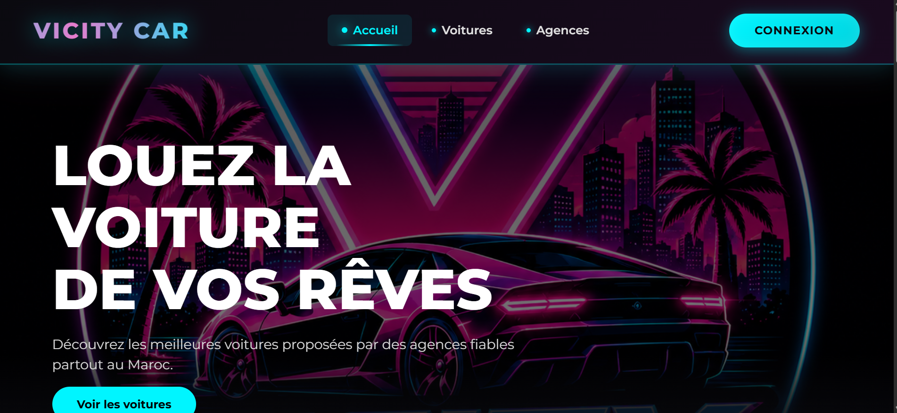

# GESTION DES VÉHICULES V2

## AYOUB AMAGHOCH

## 1. Présentation du sujet

développer une application web de gestion des véhicules.
## 2. Objectif du projet
L'objectif de  projet est de créer une application web pour gérer les voitures.
L'utilisateur peut ajouter, afficher, modifier et supprimer des voitures.
## 3. Les fonctionnalités
L'application permet de :

- Ajouter une voiture.
- Afficher les voitures.
- Modifier une voiture.
- Supprimer une voiture.
## 4. Les étapes de gestion

1. Ouvrir .
2. Ajouter .
3. Modifier .
4. Supprimer .

## 5. Les tâches du projet
- [x] Créer le projet.

 ## 6. Liens utiles

[Mon projet GitHub](https://github.com/AyoubAmaghouch/projet_technique_mobile)

## 7. Image du projet

## 8. Technologie
| HTML |
| Tailwind CSS |
| JavaScript |
| PHP |
| JSON |.
## 9. Exemple de code
```javascript
const API_URL = "../backend/api/vehicles.php";

console.log("Gestion des véhicules");
 ```

## 10. Citation
- ecrire un code simple et propre
## 11. Conclusion
- notre app facile de utilisation
---
MERCI!