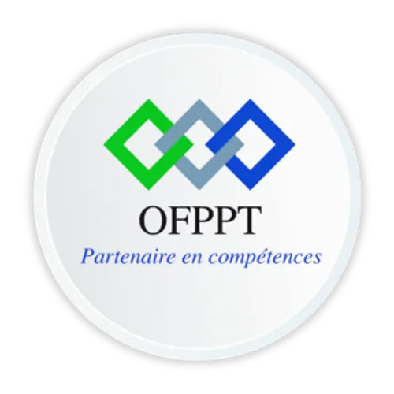

<!-- _class: cover -->
<!-- _paginate: false -->

 

# LAB POO : NOTIONS AVANCÉES EN PHP

## Classes Abstraites, Interfaces, Héritage, Polymorphisme, Encapsulation & Statique

<div class="cover-meta">
  <div>
    <strong>Projet technique :</strong> Gestion des Véhicules V2<br>
    <strong>Formation :</strong> Développeur Full Stack
  </div>
  <div>
    <strong>Nom de l'apprenant :</strong> Ayoub Amaghouch<br>
    <strong>Encadrant :</strong> ES-Sarraj Fouad
  </div>
</div>

---

# PLAN DE PRÉSENTATION

<div class="grid-2">
  <div class="card card-primary">
    <h3>1. Introduction & Stack Technique</h3>
    <ul>
      <li>Projet <strong>Gestion des Véhicules V2</strong></li>
      <li>Architecture backend en PHP Native Orienté Objet</li>
    </ul>

    <h3 style="margin-top: 8px;">2. Définitions des Notions Clés</h3>
    <ul>
      <li><strong>Modèles & Contrats :</strong> Classe abstraite & Interface</li>
      <li><strong>Réutilisation & Variabilité :</strong> Héritage & Polymorphisme</li>
      <li><strong>Sécurité & Portée :</strong> Encapsulation & Statique</li>
    </ul>
  </div>

  <div class="card">
    <h3>3. Problème Réel Rencontré</h3>
    <ul>
      <li>Rigidité d'un code procédural ou mono-classe</li>
      <li>Modification directe et non contrôlée des données</li>
      <li>Incapacité à gérer des types variés (Voiture, Camion)</li>
    </ul>

    <h3 style="margin-top: 8px;">4. Solution & Démonstrations Pratiques</h3>
    <ul>
      <li>Quick Start & Démonstration "Hello World"</li>
      <li>Démonstrations ciblées sur chaque notion clé</li>
      <li>Architecture globale et validation des scripts</li>
    </ul>
  </div>
</div>

---

# 1. INTRODUCTION & STACK TECHNIQUE

<div class="grid-2">
  <div class="card">
    <h3>🚗 Projet : Gestion des Véhicules V2</h3>
    <p>Application de gestion d'une flotte automobile hétérogène (citadines, berlines, utilitaires, poids lourds).</p>
    <ul>
      <li>Cycle complet <strong>CRUD</strong> sur les véhicules du parc.</li>
      <li>Calcul de coûts de location selon le type d'engin.</li>
      <li>Contrôle strict des caractéristiques (statut, kilométrage).</li>
      <li>Persistance des données au format JSON structuré.</li>
    </ul>
  </div>

  <div class="card card-primary">
    <h3>⚙️ Stack Technique & Rôle de la POO</h3>
    <table>
      <thead>
        <tr>
          <th>Composant</th>
          <th>Technologie</th>
          <th>Rôle Architectural</th>
        </tr>
      </thead>
      <tbody>
        <tr>
          <td><strong>Frontend</strong></td>
          <td>HTML5 / Tailwind / JS</td>
          <td>Tableau de bord et formulaires réactifs</td>
        </tr>
        <tr>
          <td><strong>Backend</strong></td>
          <td>PHP 8.5 Native (POO)</td>
          <td>Modèles métier, contrats et règles de gestion</td>
        </tr>
        <tr>
          <td><strong>Stockage</strong></td>
          <td>JSON (<code>vehicles.json</code>)</td>
          <td>Persistance sérialisée des objets</td>
        </tr>
      </tbody>
    </table>
    <p style="font-size: 12.5px; margin-top: 6px; color: #475569;">
      <strong>Enjeu du Lab :</strong> transformer un code procédural basique en une architecture objet modulaire, robuste et facilement extensible.
    </p>
  </div>
</div>

---

# 2. DÉFINITIONS DES NOTIONS CLÉS (PARTIE 1)

<div class="grid-3">
  <div class="card">
    <span class="badge badge-purple">Modèle</span>
    <h3>1. Classe Abstraite</h3>
    <p>Classe modèle incomplète qui ne peut pas être instanciée directement (<code>abstract class</code>).</p>
    <ul>
      <li>Fournit une base commune (propriétés et méthodes concrètes).</li>
      <li>Impose des méthodes abstraites obligatoires aux classes enfants.</li>
      <li>Ex : <code>abstract class Vehicule</code>.</li>
    </ul>
  </div>

  <div class="card">
    <span class="badge badge-blue">Contrat</span>
    <h3>2. Interface</h3>
    <p>Contrat strict définissant la liste des méthodes publiques obligatoires qu'une classe doit implémenter (<code>interface</code>).</p>
    <ul>
      <li>Ne contient aucun code concret (signature pure).</li>
      <li>Une classe peut implémenter plusieurs interfaces.</li>
      <li>Ex : <code>VehiculeRepositoryInterface</code>.</li>
    </ul>
  </div>

  <div class="card">
    <span class="badge badge-emerald">Partage</span>
    <h3>3. Héritage</h3>
    <p>Mécanisme permettant à une classe fille de dériver d'une classe parente avec le mot-clé <code>extends</code>.</p>
    <ul>
      <li>Réutilise le code commun sans duplication.</li>
      <li>Permet d'ajouter des propriétés spécifiques.</li>
      <li>Ex : <code>class Camion extends Vehicule</code>.</li>
    </ul>
  </div>
</div>

---

# 2. DÉFINITIONS DES NOTIONS CLÉS (PARTIE 2)

<div class="grid-3">
  <div class="card">
    <span class="badge badge-amber">Flexibilité</span>
    <h3>4. Polymorphisme</h3>
    <p>Capacité à traiter différents objets enfants via un type parent commun, chacun réagissant selon sa propre implémentation.</p>
    <ul>
      <li>Une même méthode produit des effets adaptés à chaque type.</li>
      <li>Évite les cascades de conditions <code>if / else</code>.</li>
      <li>Ex : <code>$vehicule->calculerCout($jours)</code>.</li>
    </ul>
  </div>

  <div class="card">
    <span class="badge badge-red">Protection</span>
    <h3>5. Encapsulation</h3>
    <p>Dissimulation des détails internes d'un objet en restreignant l'accès aux données (<code>private</code>, <code>protected</code>).</p>
    <ul>
      <li>Accès contrôlé via <em>Getters</em> et <em>Setters</em>.</li>
      <li>Garantit l'intégrité (refus de données invalides).</li>
      <li>Ex : <code>setKilometrage(int $km)</code>.</li>
    </ul>
  </div>

  <div class="card">
    <span class="badge badge-blue">Portée</span>
    <h3>6. Éléments Statiques</h3>
    <p>Propriétés et méthodes rattachées à la classe elle-même plutôt qu'à une instance spécifique (<code>static</code>).</p>
    <ul>
      <li>Accessibles sans instanciation via <code>Classe::methode()</code>.</li>
      <li>Idéal pour les compteurs globaux et fonctions utilitaires.</li>
      <li>Ex : <code>Vehicule::validerPlaque($p)</code>.</li>
    </ul>
  </div>
</div>

---

# 3. PROBLÈME RÉEL RENCONTRÉ DANS LE PROJET

Dans une première version sans POO avancée, l'application Gestion des Véhicules V2 souffre de faiblesses critiques :

<div class="grid-3">
  <div class="card card-alert">
    <span class="badge badge-red">Problème 1</span>
    <h3 style="color: #991b1b;">Données Corrompues</h3>
    <p>Les propriétés étaient publiques (<code>$v->km = -500;</code>). N'importe quel script pouvait corrompre le kilométrage ou attribuer un statut farfelu sans contrôle préalable.</p>
  </div>

  <div class="card card-alert">
    <span class="badge badge-red">Problème 2</span>
    <h3 style="color: #991b1b;">Spaghetti Multi-Types</h3>
    <p>Pour calculer le tarif d'un camion ou d'une voiture, le code multipliait les vérifications manuelles :</p>
    <pre><code class="language-php">if ($type == "camion") { ... }
else if ($type == "voiture") { ... }</code></pre>
    <p>Ajouter un type moto obligeait à modifier tout le code existant.</p>
  </div>

  <div class="card card-alert">
    <span class="badge badge-red">Problème 3</span>
    <h3 style="color: #991b1b;">Absence de Contrat</h3>
    <p>Le module de stockage écrivait directement dans le JSON. Remplacer le fichier par une base SQL nécessitait de réécrire tous les fichiers du projet au lieu de changer une implémentation.</p>
  </div>
</div>

---

# 4. SOLUTION — QUICK START & HELLO WORLD

Démonstration minimaliste combinant encapsulation, héritage et polymorphisme dans un script exécutable :

```php
<?php
// Classe abstraite avec encapsulation et méthode polymorphe
abstract class VehiculeDemo {
    private int $kilometrage = 0; // Donnée protégée (encapsulation)

    public function __construct(protected string $marque, protected float $tarifJour) {}

    public function setKm(int $km): void {
        if ($km < $this->kilometrage) { throw new InvalidArgumentException("Kilométrage incohérent !"); }
        $this->kilometrage = $km;
    }

    abstract public function calculerTarif(int $jours): float; // Signature imposée
}

class VoitureDemo extends VehiculeDemo {
    public function calculerTarif(int $jours): float { return $this->tarifJour * $jours; }
}

class CamionDemo extends VehiculeDemo {
    public function calculerTarif(int $jours): float { return ($this->tarifJour * $jours) + 200.0; /* Forfait tonnage */ }
}

// Test du polymorphisme : même appel, résultats adaptés !
$flotte = [new VoitureDemo("Clio", 40.0), new CamionDemo("Volvo", 120.0)];
foreach ($flotte as $v) { echo get_class($v) . " pour 3 jours : " . $v->calculerTarif(3) . " DH\n"; }
```

---

# 4.1 SOLUTION : ENCAPSULATION & ÉLÉMENTS STATIQUES

<div class="grid-2">
  <div>
    <h3>Encapsulation : Accès Contrôlé</h3>
    <pre><code class="language-php">&lt;?php
class Vehicule {
    private int $kilometrage = 0;
    private string $statut = 'Disponible';

    public function getKilometrage(): int {
        return $this-&gt;kilometrage;
    }

    public function setKilometrage(int $km): void {
        if ($km &lt; $this-&gt;kilometrage) {
            throw new \Exception("Nouveau km inférieur à l'ancien !");
        }
        $this-&gt;kilometrage = $km;
    }
}
</code></pre>
  </div>

  <div>
    <h3>Membres Statiques : Compteur & Outils</h3>
    <pre><code class="language-php">&lt;?php
class VehiculeUtil {
    // Propriété statique : partagée par toute la classe
    public static int $totalVehicules = 0;

    // Méthode statique utilitaire
    public static function validerPlaque(string $plaque): bool {
        return (bool) preg_match('/^[0-9]{1,5}-[A-Z]-[0-9]{1,2}$/', trim($plaque));
    }
}

// Appel direct sans instanciation
if (VehiculeUtil::validerPlaque("12345-A-1")) {
    VehiculeUtil::$totalVehicules++;
}
</code></pre>
  </div>
</div>

<div class="card card-success" style="margin-top: 4px; padding: 5px 12px; font-size: 13px;">
  <strong>Résultat :</strong> Les données métier sont inviolables et les règles transversales sont centralisées proprement.
</div>

---

# 4.2 SOLUTION : CLASSE ABSTRAITE & HÉRITAGE

Modélisation hiérarchique évitant la duplication de code entre les différents types de véhicules :

```text
               abstract class Vehicule (id, marque, modele, tarifBase)
                              ▲
               ┌──────────────┴──────────────┐
               │                             │
    class Voiture (places)         class Camion (tonnageMax)
```

<div class="grid-2" style="margin-top: 4px;">
  <div>
    <h3>Base Abstraite : <code>Vehicule</code></h3>
    <pre><code class="language-php">&lt;?php
abstract class Vehicule {
    public function __construct(
        protected int $id,
        protected string $immat,
        protected float $tarifBase
    ) {}

    // Méthode abstraite imposée aux enfants
    abstract public function calculerCout(int $jours): float;
}
</code></pre>
  </div>

  <div>
    <h3>Héritage Concret : <code>Camion</code></h3>
    <pre><code class="language-php">&lt;?php
class Camion extends Vehicule {
    public function __construct(int $id, string $immat, float $tarif, private float $tonnage) {
        parent::__construct($id, $immat, $tarif);
    }

    public function calculerCout(int $jours): float {
        return ($this-&gt;tarifBase * $jours) + ($this-&gt;tonnage * 50);
    }
}
</code></pre>
  </div>
</div>

---

# 4.3 SOLUTION : INTERFACE & POLYMORPHISME

Découplage complet de l'application grâce au polymorphisme et aux interfaces :

<div class="grid-2">
  <div>
    <h3>Contrat : <code>VehiculeStorageInterface</code></h3>
    <pre><code class="language-php">&lt;?php
interface VehiculeStorageInterface {
    public function sauvegarder(Vehicule $v): bool;
    public function trouverParId(int $id): ?Vehicule;
    public function recupererTous(): array;
}

// Implémentation JSON actuelle
class JsonVehiculeStorage implements VehiculeStorageInterface {
    public function sauvegarder(Vehicule $v): bool {
        // Écriture sérialisée dans vehicles.json...
        return true;
    }
    // ...
}
</code></pre>
  </div>

  <div>
    <h3>Polymorphisme en Action</h3>
    <pre><code class="language-php">&lt;?php
class GestionnaireFlotte {
    public function __construct(private VehiculeStorageInterface $storage) {}

    // Traite n'importe quel Vehicule de façon transparente !
    public function facturer(Vehicule $vehicule, int $jours): float {
        return $vehicule-&gt;calculerCout($jours);
    }

    public function enregistrer(Vehicule $vehicule): void {
        $this-&gt;storage-&gt;sauvegarder($vehicule);
    }
}
</code></pre>
  </div>
</div>

<div class="card card-primary" style="margin-top: 4px; padding: 5px 12px; font-size: 13px;">
  <strong>Bénéfice majeur :</strong> L'application peut changer de type de véhicule ou de stockage sans modifier une seule ligne du gestionnaire.
</div>

---

# 4.4 SOLUTION GLOBALE & LIVRABLES DU LAB

Récapitulatif des 6 piliers objet intégrés dans le projet **Gestion des Véhicules V2** :

<div class="grid-3">
  <div class="card card-success">
    <span class="badge badge-emerald">Pilier 1 & 2</span>
    <h3>Abstraite & Héritage</h3>
    <p>Hiérarchie unifiée <code>Vehicule</code> ➔ <code>Voiture</code> / <code>Camion</code> évitant toute duplication.</p>
  </div>

  <div class="card card-success">
    <span class="badge badge-emerald">Pilier 3 & 4</span>
    <h3>Interface & Polymorphisme</h3>
    <p>Contrats de stockage et calculs tarifaires dynamiques sans cascades de conditions.</p>
  </div>

  <div class="card card-success">
    <span class="badge badge-emerald">Pilier 5 & 6</span>
    <h3>Encapsulation & Statique</h3>
    <p>Protection stricte des données et fonctions d'audit/validation globales.</p>
  </div>
</div>

<div class="card" style="margin-top: 10px; background: #0f172a; color: #f8fafc; padding: 10px 14px; font-family: Consolas, monospace; font-size: 12.5px;">
  <span style="color: #38bdf8;">$ php classe-abstraite/exemple.php</span> ➔ Classe modèle de base et contrat abstrait<br>
  <span style="color: #38bdf8;">$ php interface/exemple.php</span>        ➔ Contrat de dépôt et persistance interchangeable<br>
  <span style="color: #38bdf8;">$ php heritage/exemple.php</span>         ➔ Spécialisation des véhicules Voiture et Camion<br>
  <span style="color: #38bdf8;">$ php polymorphisme/exemple.php</span>     ➔ Traitement dynamique et boucle de calcul unifiée<br>
  <span style="color: #38bdf8;">$ php encapsulation/exemple.php</span>     ➔ Protection du kilométrage et validation métier<br>
  <span style="color: #38bdf8;">$ php statique/exemple.php</span>          ➔ Compteur de flotte et validateur d'immatriculation
</div>

