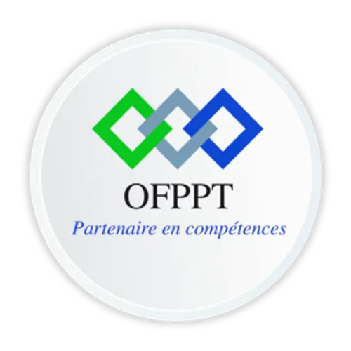
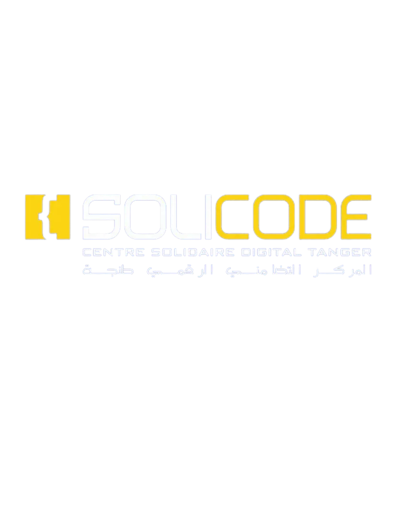

<!-- _class: title -->

  
  

# LAB — PRODUCT BACKLOG

## Blog des Lauréats

**Apprenant :*Ayoub Amaghouch*  &nbsp; · &nbsp; **Encadrant :*ES-Sarraj Fouad* 

---

<!-- _class: light -->

## PLAN DE PRÉSENTATION

1. **Introduction & Stack Technique** — contexte et périmètre du projet
2. **Définitions** — notions clés du Product Backlog
3. **Problème** — comprendre les besoins réels des utilisateurs
4. **Solution** — démarche Design Thinking et backlog à prioriser

---

## 01 — INTRODUCTION & STACK TECHNIQUE

### Blog des Lauréats

Une plateforme web où les lauréats peuvent partager leurs expériences, leurs connaissances et leurs conseils avec les étudiants.

- **Objectif :** préparer les fonctionnalités à développer à partir des besoins des utilisateurs.
- **Acteurs :** administrateur, lauréat (auteur) et visiteur.
- **Périmètre du lab :** analyser les besoins, formuler des User Stories et construire un Product Backlog.
- **Stack technique :** non précisée dans le README du lab; elle sera définie pendant la conception technique.

---

<!-- _class: light -->

## 02 — DÉFINITIONS

| Notion | Définition |
|:---|:---|
| **Product Backlog** | Liste ordonnée des fonctionnalités, besoins et améliorations d’un produit. |
| **User Story** | Besoin formulé du point de vue d’un utilisateur : « En tant que…, je veux…, afin de… ». |
| **Priorisation** | Classement des éléments selon leur valeur, leur urgence et les objectifs du produit. |
| **Prototype** | Représentation simple d’une solution, utilisée pour la présenter et recueillir des retours. |
| **Design Thinking** | Démarche centrée sur les utilisateurs pour comprendre un problème et explorer des solutions. |

---

## 03 — PROBLÈME

### Comment éviter de développer des fonctionnalités qui ne répondent pas aux attentes ?

Au démarrage du Blog des Lauréats, les besoins des visiteurs, des auteurs et de l’administrateur doivent être compris avant de choisir les fonctionnalités.

- Les attentes des utilisateurs peuvent être différentes.
- Une idée de fonctionnalité n’est pas encore un besoin validé.
- Sans organisation ni priorité, le backlog risque de devenir une simple liste de demandes.

**Enjeu du lab :** construire un backlog pertinent, fondé sur les besoins utilisateurs plutôt que sur des suppositions.

---

<!-- _class: light -->

## 04 — SOLUTION : PARTIR DES UTILISATEURS

### Une démarche progressive de Design Thinking

<strong>1 · Comprendre</strong> Identifier les acteurs et recueillir leurs attentes.

<strong>2 · Définir</strong> Formaliser les besoins et les difficultés observés.

<strong>3 · Imaginer</strong> Proposer des réponses possibles au problème prioritaire.

<strong>4 · Prototyper</strong> Représenter les solutions avec des maquettes simples.

<strong>5 · Organiser</strong> Transformer les besoins retenus en User Stories.

<strong>6 · Prioriser</strong> Ordonner les éléments du Product Backlog avec l’équipe.

---

## LES ACTEURS ET LEURS INTERACTIONS

### Trois rôles dans le système

- **Administrateur** — gère les utilisateurs et les publications.
- **Lauréat / auteur** — rédige et gère ses articles.
- **Visiteur** — consulte les articles publiés.

### Du besoin à la fonctionnalité

| Acteur | Besoin du périmètre |
|:---|:---|
| Administrateur | Gérer les utilisateurs et les publications |
| Lauréat | Rédiger et gérer ses articles |
| Visiteur | Consulter les articles publiés |

*Ces interactions reprennent le diagramme de contexte fourni avec le lab.*

---

<!-- _class: light -->

## DES BESOINS AUX USER STORIES

### Exemples à confirmer avec les utilisateurs

| Acteur | User Story |
|:---|:---|
| Visiteur | En tant que visiteur, je veux consulter les articles publiés afin de découvrir les expériences des lauréats. |
| Lauréat | En tant que lauréat, je veux rédiger et gérer mes articles afin de partager mes connaissances. |
| Administrateur | En tant qu’administrateur, je veux gérer les utilisateurs et les publications afin de maintenir le blog organisé. |

**À retenir :** une User Story décrit un besoin; les échanges avec les utilisateurs servent à la valider et à préciser ses critères d’acceptation.

---

## ORGANISER LE PRODUCT BACKLOG

### Un backlog clair et évolutif

| Ordre | Élément | Priorité |
|:---:|:---|:---:|
| À définir | Consulter les articles publiés | À arbitrer |
| À définir | Rédiger et gérer ses articles | À arbitrer |
| À définir | Gérer les utilisateurs et les publications | À arbitrer |

- Découper les besoins en éléments compréhensibles et discutables.
- Évaluer leur valeur pour les utilisateurs et les objectifs du projet.
- Définir les priorités avec les parties prenantes; aucun ordre n’est fourni dans le README.

---

<!-- _class: light -->

## LIVRABLE ATTENDU

### Un backlog prêt à guider le premier Sprint

- Diagramme de contexte des acteurs et de leurs interactions.
- Résultats de l’activité d’empathie et besoins formalisés.
- Problèmes prioritaires et solutions proposées.
- Maquettes de prototypes.
- User Stories validées et Product Backlog priorisé.

**Résultat visé :** une base de travail structurée pour préparer le lancement du premier Sprint Scrum.
