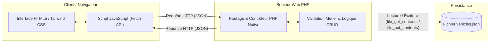

# Lab : Introduction aux Labs & Stack Technique

> **Projet Technique de Référence :** Gestion des Véhicules V2  
> **Apprenant :** Ayoub Amaghouch  
> **Encadrant :** ES-Sarraj Fouad  
> **Formation :** Développeur Full Stack  
> **Date :** 02 Novembre 2026 | **Version :** 1.0  
> **Livrables associés :** [Présentation Marp](file:///c:/Lab/lab-stack/presentation.md) | [Prompt de conception](file:///c:/Lab/lab-stack/prompt.md)

---

## 1. Contexte du Lab

Dans le cadre du cursus de formation **Développeur Full Stack**, la réalisation du projet technique **Gestion des Véhicules V2** constitue le fil conducteur pratique permettant de valider les compétences en développement web moderne.

Le projet consiste à concevoir et développer une application web de gestion de flotte automobile permettant d'effectuer l'ensemble des opérations **CRUD** (*Create, Read, Update, Delete*) de façon fluide, réactive et sécurisée. L'application s'appuie sur une interface utilisateur soignée (**HTML5**, **Tailwind CSS**, **JavaScript**), un serveur de traitement robuste en **PHP Native** et un mécanisme de persistance autonome au format **JSON**.

Ce **Lab d'introduction** constitue la porte d'entrée méthodologique et technologique vers ce projet. Il pose les fondations en explicitant le rôle de chaque brique technique, la dynamique des Labs pratiques et la feuille de route des 30 Labs répartis sur quatre phases.

---

## 2. Objectifs Pédagogiques

À l'issue de ce Lab, l'apprenant sera capable de :

- **Comprendre le concept de Lab** et son importance pédagogique dans la montée en compétences (*Learning by Doing*).
- **Identifier et expliquer chaque composant de la stack technique** du projet Gestion des Véhicules V2.
- **Comprendre le rôle précis de chaque technologie** (Frontend, Backend, Stockage, Outillage) et leur interaction.
- **Schématiser l'architecture client-serveur** et le cycle d'échange de données via une API RESTful / JSON.
- **Établir le lien direct entre les compétences travaillées en Labs et les fonctionnalités du projet final**.
- **Visualiser la trajectoire d'apprentissage** à travers les 30 Labs organisés en 4 phases progressives.

---

## 3. Présentation du Projet Technique : Gestion des Véhicules V2

### 3.1 Définition et Besoins Métier
L'application **Gestion des Véhicules V2** a pour vocation de remplacer les suivis manuels ou tableurs dispersés par une interface web centralisée, intuitive et accessible. Elle permet à un gestionnaire de flotte de suivre en temps réel l'état, les caractéristiques et la disponibilité de ses véhicules.

### 3.2 Objectifs du Projet
- **Centralisation :** Regrouper l'intégralité des véhicules dans une source de données unique.
- **Simplicité & Ergonomie :** Offrir une expérience utilisateur fluide avec des retours visuels immédiats sans rechargement lourd de page.
- **Intégrité des données :** Assurer la cohérence des informations enregistrées (champs obligatoires, formats de plaques, kilométrage).
- **Architecture évolutive :** Séparer clairement la couche de présentation (frontend) de la logique de traitement (backend).

### 3.3 Fonctionnalités Principales & Matrice CRUD

| Opération | Verbe HTTP | Endpoint API (Exemple) | Description Métier |
| :--- | :---: | :--- | :--- |
| **Create (Ajouter)** | `POST` | `/api/vehicles.php` | Enregistrer un nouveau véhicule (marque, modèle, année, immatriculation, statut). |
| **Read (Consulter)** | `GET` | `/api/vehicles.php`<br>`/api/vehicles.php?id={id}` | Lister la totalité des véhicules ou afficher la fiche détaillée d'un véhicule spécifique. |
| **Update (Modifier)** | `PUT` / `POST` | `/api/vehicles.php?id={id}` | Mettre à jour les informations d'un véhicule existant (ex : kilométrage, disponibilité). |
| **Delete (Supprimer)** | `DELETE` / `POST` | `/api/vehicles.php?id={id}` | Retirer définitivement un véhicule du parc avec confirmation préalable. |

---

## 4. Stack Technique & Rôles des Technologies

### 4.1 Frontend (Interface Utilisateur)
- **HTML5 :** Assure la structure sémantique des pages (tableaux de bord, formulaires d'ajout/édition, modales).
- **Tailwind CSS :** Framework CSS *utility-first* permettant de construire une interface moderne, responsive, épurée et cohérente rapidement.
- **JavaScript (ES6+) :** Dynamise l'interface, intercepte les événements utilisateurs (clic, soumission de formulaires), manipule le DOM en temps réel et orchestre les échanges asynchrones avec l'API (`fetch`).

### 4.2 Backend (Logique Métier & Données)
- **PHP Native :** Traite les requêtes HTTP entrantes, applique les règles de validation métier, contrôle les données et génère les réponses adéquates.
- **API PHP :** Couche de routage et de standardisation exposant des points d'accès retournant des charges utiles au format standardisé `application/json`.
- **Fichiers JSON :** Système de persistance léger, lisible par l'humain et ne nécessitant pas de configuration complexe de SGBD pour les phases initiales.

### 4.3 Outils de Développement & Collaboration
- **Visual Studio Code :** Environnement de développement intégré (extensions Tailwind, PHP, Marp, GitLens).
- **Git :** Contrôle de versions distribué pour historiser chaque étape de développement.
- **GitHub :** Dépôt distant, publication de la documentation et collaboration.

### 4.4 Schéma Général de l'Architecture Technique



---

## 5. Méthodologie Pédagogique : Comprendre les Labs

### 5.1 Qu'est-ce qu'un Lab ?
Un **Lab** est une unité d'apprentissage pratique, autonome et ciblée. Contrairement à un cours purement magistral, un Lab isole une compétence, un outil ou un mécanisme précis pour permettre à l'apprenant de l'expérimenter directement, d'en observer le comportement et d'en maîtriser la mise en œuvre.

### 5.2 Pourquoi cette approche ?
- **Apprentissage actif (*Learning by Doing*) :** On retient mieux ce que l'on manipule et construit soi-même.
- **Isolation des difficultés :** Apprendre Tailwind CSS ou PHP Native séparément évite la surcharge cognitive liée au projet global.
- **Capitalisation :** Chaque Lab produit un livrable réutilisable (snippet, template, composant, documentation).

### 5.3 Correspondances directes : Du Lab au Projet Technique

```
┌─────────┐      ┌───────────────┐      ┌────────────────┐      ┌──────────────────────────┐
│   LAB   │ ───▶ │ APPRENTISSAGE │ ───▶ │ EXPÉRIMENTATION│ ───▶ │ INTÉGRATION DANS PROJET  │
└─────────┘      └───────────────┘      └────────────────┘      └──────────────────────────┘
```

| Lab Réalisé | Compétence Acquise | Application dans Gestion des Véhicules V2 |
| :--- | :--- | :--- |
| **Lab 2 : Markdown** | Rédaction et structuration documentaire | Production du README, de la doc technique et des guides |
| **Lab 5 : Marp** | Génération de présentations en Markdown | Présentation de soutenance et restitution du projet |
| **Lab 9 : Tailwind CSS** | Design responsive et utility classes | Stylisation de l'interface et du tableau de bord des véhicules |
| **Lab 10 : Preline** | Intégration de composants UI préconçus | Intégration de tableaux, modales et formulaires élégants |
| **Lab 13 : Issues (GitHub)** | Gestion et traçabilité des tâches | Planification et suivi des tickets de développement CRUD |
| **Lab 17 : OOP** | Conception orientée objet | Modélisation de la classe `Vehicle` et de la classe `VehicleRepository` |
| **Lab 18 : PHP Native** | Développement serveur sans framework | Écriture du contrôleur d'API et manipulation des fichiers JSON |
| **Lab 21 : ES7 JavaScript** | Syntaxe moderne (async/await, fetch) | Consommation fluide de l'API sans rechargement de page |
| **Lab 22 : Error JS** | Gestion propre des erreurs et exceptions | Feedback utilisateur clair en cas d'erreur réseau ou validation |
| **Lab 28 : Git** | Versionnement et gestion de branches | Gestion propre des fonctionnalités et des versions du projet |

---

## 6. Programme des 30 Labs (4 Phases)

L'ensemble de la formation s'articule autour de **30 Labs** structurés en 4 phases méthodiques :

### Phase 1 : Fondations & Outils (Labs 1–10)
1. **Qu'est-ce qu'un lab ?** — Comprendre les Labs
2. **Markdown** — Syntaxe et documentation
3. **GitHub Pages** — Hébergement statique
4. **Antigravity** — Gestion de projets Python
5. **Marp** — Présentations en Markdown
6. **OpenCode** — Environnement de développement
7. **Pandoc** — Conversion de documents
8. **OmniRoute** — Routage avancé
9. **Tailwind CSS** — Framework CSS utility-first
10. **Preline** — Composants UI avec Tailwind

### Phase 2 : Méthodologies & Collaboration (Labs 11–16)
11. **2TUP** — Méthodologie de développement
12. **Design Thinking** — Approche centrée utilisateur
13. **Issues (GitHub)** — Gestion des tickets
14. **Scrum** — Méthode agile
15. **Copilot GitHub** — IA pour le développement
16. **ASCII** — Art et diagrammes en texte

### Phase 3 : Développement & Langages (Labs 17–24)
17. **OOP** — Programmation orientée objet
18. **PHP Native** — PHP pur sans framework
19. **Laravel** — Framework PHP
20. **Kotlin** — Langage moderne pour Android/Backend
21. **ES7 JavaScript** — Features modernes JavaScript
22. **Error JS** — Gestion des erreurs JavaScript
23. **Prompt-Agent-Skill** — IA et automatisation
24. **Communication avec IA** — Interaction avec l'IA

### Phase 4 : Projet & Production (Labs 25–30)
25. **Veille technologique** — Se tenir à jour
26. **Starter** — Templates de démarrage
27. **Planning** — Planification de projet
28. **Git** — Gestion de version avancée
29. **Lab Stack** — Stack technique complète
30. **Agent** — Automatisation avec agents IA

---

## 7. Déroulement du Lab

Pour s'approprier ce Lab d'introduction, l'apprenant suit les étapes suivantes :

```text
[ Étape 1 : Découverte ]
  └─ Analyse du sujet et compréhension de la finalité du projet Gestion des Véhicules V2.

[ Étape 2 : Exploration de la Stack ]
  └─ Décortiquer le rôle de chaque brique : HTML5, Tailwind CSS, JS, PHP Native, JSON, Git.

[ Étape 3 : Cartographie des Labs ]
  └─ Identifier la place de chaque Lab parmi les 30 Labs et les 4 phases.

[ Étape 4 : Consultation & Test de la Présentation ]
  └─ Ouvrir presentation.md dans VS Code avec l'extension Marp et visualiser les 5 slides.

[ Étape 5 : Auto-évaluation & Validation ]
  └─ Vérifier la maîtrise des concepts à l'aide de la grille de validation.
```

---

## 8. Critères de Validation

| Critère | Éléments Attendus | Statut |
| :--- | :--- | :---: |
| **Concept de Lab** | Capacité à définir ce qu'est un Lab et à expliquer son intérêt pédagogique. | [ ] Validé |
| **Maîtrise de la Stack** | Connaissance du rôle précis de HTML5, Tailwind CSS, JavaScript, PHP Native et JSON. | [ ] Validé |
| **Architecture Client-Serveur** | Capacité à expliquer le cycle d'une requête HTTP/JSON entre frontend et backend. | [ ] Validé |
| **Compréhension du CRUD** | Explication claire des 4 opérations fondamentales (Create, Read, Update, Delete). | [ ] Validé |
| **Feuille de Route des Labs** | Identification des 4 phases et de la logique de progression des 30 Labs. | [ ] Validé |
| **Qualité des Livrables** | Présence d'un `README.md` exhaustif, d'une présentation Marp de 5 slides et du `prompt.md`. | [ ] Validé |

---

## 9. Ressources et Liens Utiles

- [Documentation officielle HTML5 (MDN)](https://developer.mozilla.org/fr/docs/Web/HTML)
- [Documentation officielle Tailwind CSS](https://tailwindcss.com/docs)
- [Documentation officielle JavaScript (MDN)](https://developer.mozilla.org/fr/docs/Web/JavaScript)
- [Documentation officielle PHP](https://www.php.net/manual/fr/)
- [Documentation officielle Marp](https://marp.app/)
- [Documentation officielle Git](https://git-scm.com/doc)
- [Guide Markdown GitHub Flavored](https://docs.github.com/fr/get-started/writing-on-github)

